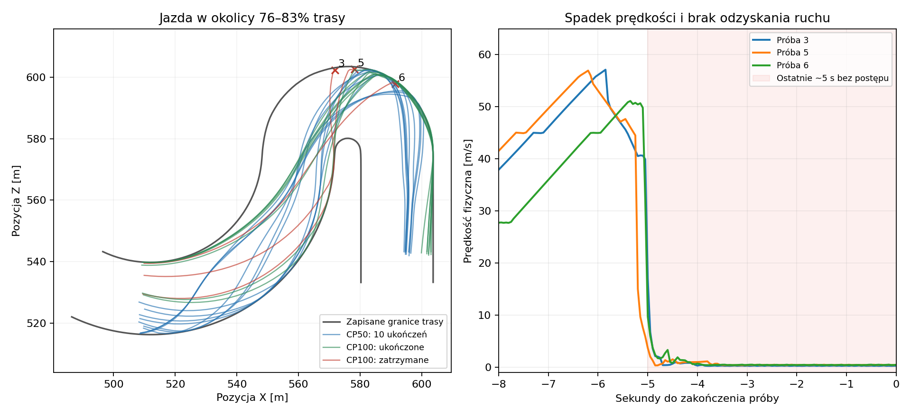

# PPO: regresja CP50 → CP100 i zatrzymania przy 81% trasy

Diagnoza wyłącznie offline, bez gry, nowych rolloutów, optymalizatora lub zmiany
checkpointów. Porównano wszystkie20 śladów ocen i477 identycznych wejść obu polityk
na CPU/jeden wątek. Wykorzystano oryginalny frozen runtime `d8f2440b`.

## Co rzeczywiście się pogorszyło

| Pomiar | CP50 | CP100 |
|---|---:|---:|
| Ukończenia | 10/10 | 7/10 |
| Średni czas ukończonych | 51,963s | 62,207s |
| Najlepszy czas | 51,12s | 58,49s |
| Średni czas wejścia na20% | 12,412s | 15,423s |
| Średni czas wejścia na60% | 32,156s | 38,453s |
| Średni czas wejścia na80% | 41,576s | 49,530s |

Każdy z siedmiu ukończonych przejazdówCP100 jest wolniejszy od najwolniejszegoCP50
(52,94s). Regresja w tych zapisach obejmuje wcześniejsze fragmenty trasy,
nie tylko pojedynczą zatoczkę przy81%. Osobne oceny nie stanowią sparowanego,
randomizowanego testu; dziesięć prób nie ustala niezawodności na wielu seedach.

## Mechanizm trzech zatrzymań

To końcowe próby o indeksach2/4/5 (numery3/5/6 na rysunku), postęp80,673/80,858/81,227%.
Prędkość fizyczna gwałtownie spada z kilkudziesięciu m/s praktycznie do zera,
auto pozostaje przy zewnętrznej krawędzi nawrotu. Końcowe pozycje znajdują się
0,741/0,917/0,823m od najbliższej próbki zapisanej prawej granicy geometrii.
To silna przesłanka kontaktu z bandą; sam ślad nie jest nagraniem obrazu ani
niezależnym czujnikiem kontaktu. Nie wyprowadzamy kolizji wyłącznie z crash_rate.

W ostatnich100 krokach (~5s) przemieszczenie netto wynosi tylko0,248/0,208/0,522m,
średni gaz0,922/0,907/0,838, hamulec0,192/0,168/0,103. Plyn nie znika,
lecz polityka nie odzyskuje postępu. Liczniksteps_since_progress osiąga100,
dokładnie limit zamrożonej konfiguracji: prawidłowe zakończenie `no_progress`.
`crash_rate=0` nie wyklucza kontaktu z bandą: raport bazuje na jawnych flagach
i przyczynach zakończenia; te trzy epizody kończą się no_progress.

Jeden120ms odstęp w próbie2 wystąpił wcześniej przy75,23% i mógł lokalnie
wpłynąć na tę jazdę. Pozostałe dwie nieudane próby nie mają przekroczenia100ms.
Nie ma podstaw przypisać całej regresji temu jednemu zdarzeniu.

## Co zmieniło uczenie

Na477 wspólnych obserwacjach odtworzono przyczynowy pipelineV5 od resetu,
transformując kolejne raw_next dokładnie w kolejności zapisanej oceny. Modele
otrzymują aktualne wejścia, bez poakcyjnych liczników/reason/etykiet jako cech.
Maksymalny błąd odtworzenia własnych zapisanych akcji:0,000001282. Obserwacje
nie są normalizowane, oba modele pracują w trybie deterministic EVALUATION.

Na45 próbkachCP50 z regionu78–80% średnia komenda skrętu zmienia się z−0,0216
na+0,2094; średnia bezwzględna różnica skrętu0,4994 w zakresie[−1,1]. Na97 próbkach
80–82% korekta zmienia się z−0,5461 na−0,2722. To bezpośredni dowód zmiany
polityki na tych samych wejściach, nie tylko porównanie innych stanów jazdy.
Nie dowodzi, że sama podmiana akcjiCP50 uratowałaby konkretny przejazd;
tego nie testowano w środowisku. W próbachCP100 występuje mocne sterowanie
w prawo przed nawrotem i niewystarczające wyprowadzenie toru jazdy; przy bandzie
komendy również różnią się odCP50 i nie tworzą skutecznego odzyskania ruchu.

Trening optymalizuje politykę z próbkowanymi akcjami, ocena używa deterministycznej
średniej po transformacji. Liczba ukończeń w50 rolloutach rośnie8→40,
średnia nagroda na rollout128,96→279,46, podczas gdy końcowa ocena się pogarsza.
Każda połowa ma50 wymuszonych granic rolloutów; tych liczb nie wolno nazywać
bezwarunkowym procentem ukończeń. Lepszy treningowy zwrot nie gwarantuje
lepszej jazdy deterministycznej.

LR wokół resume przebiega ciągle: update50=0,000296325,51=0,000296250,
100=0,000292575. Źródło restore odtwarza model,Adam,normalizery i licznikprocessed;
nie ma śladu resetu harmonogramu. Brak kontrolnej, nieprzerwanej próby, więc
nie przypisujemy przyczyny wznowieniu ani nie dowodzimy jego pełnej neutralności.
LatentstdCP50=[0,970;0,904;0,959],CP100=[0,960;0,845;0,928]: brak przesłanki
załamania wariancji do zera. Ujemna entropia akcji ciągłych nie jest takim dowodem.
Value loss nie rośnie monotonicznie poCP50; blok91–100 ma średnio1,459 wobec2,329
w41–50. EV pozostaje zmienne. Nie ustalono błędu optymalizatora, clippingu ani
przyczyny wymagającej konkretnej zmianyLR/entropy/gamma.

## Decyzja przed długim treningiem

Nie uruchamiać teraz kolejnego treningu ani ponownej oceny. ZachowaćCP50 iCP100,
oryginalne wyniki oraz końcoweFAIL. Następna uzasadniona zmiana procesu to
planowane śledzenie jakości deterministycznej i regresji odcinków w trakcie
długiego treningu, z oddzielnymi próbami do wyboru checkpointu i końcowej walidacji.
Nie podmieniać obecnej bramkiCP100 wcześniejszym10/10 ani nie dobierać
hiperparametrów na podstawie jednego dobrego snapshotu.

Konkretny problem do późniejszego eksperymentu: stabilność wejścia i korekty
na nawrocie78–82% oraz odzyskanie ruchu po kontakcie. Wybór poprawki algorytmu
wymaga kontrolowanego porównania; obecne dane ustalają mechanizm jazdy i drift
aktorów, ale nie wskazują jednoznacznie parametru, który trzeba zmienić.

Dowody: `evidence/ppo-trend-continuation-20261013-r2/regression-audit.json`
(477 matched states, SHA obuCP, trainingblocks), `regression-summary.json`,
`regression-trajectories.png`. Skrypt: `pilot_tools/audit_ppo_regression.py`.
Ruff/mypyPASS; kontrola odtworzenia akcji i SHA checkpointówPASS. Zerooptimizersteps.
