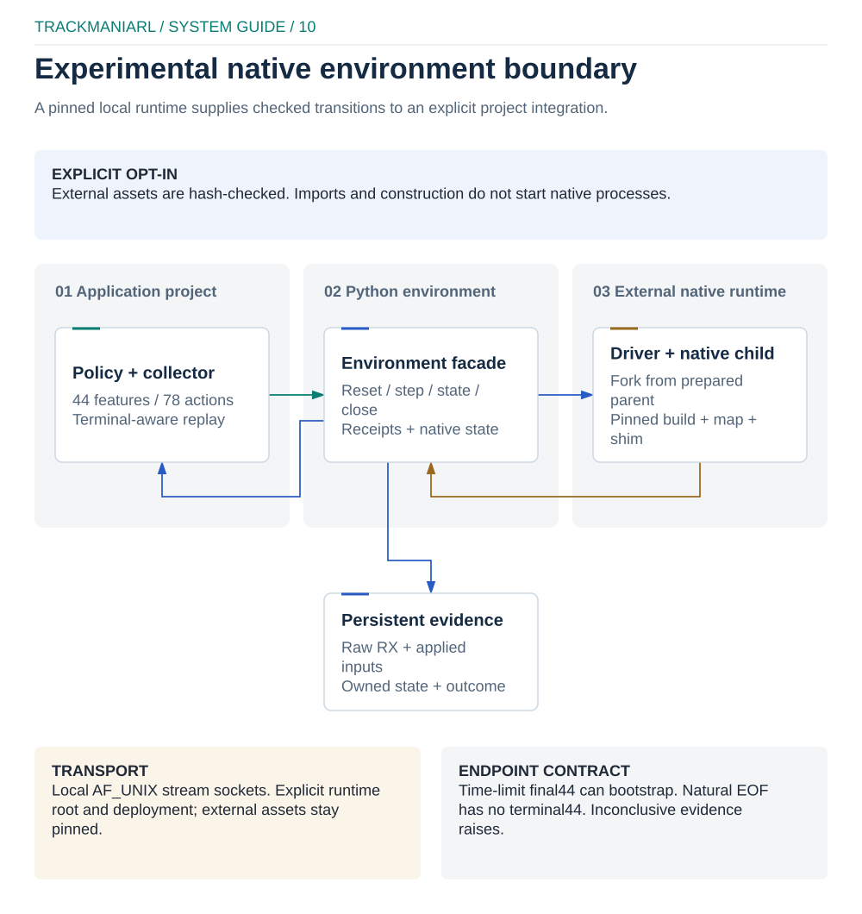

# Experimental native headless environment

This optional backend runs a pinned Linux native simulation through a local
driver. It provides explicit reset, state, action and close operations without
the Openplanet telemetry connection. It is an experimental integration for one
validated build and map; existing CLI defaults and generated game projects keep
their current behavior.

The Python implementation belongs to `trackmaniarl.trackmania.native_headless`.
It does not import scripts from a research checkout. Native binaries, map data
and validation inputs are external, hash-checked assets and are not distributed
with the Python package.

## Scope and prerequisites

- Linux with local Unix-domain sockets and process identity support. Importing
  the package on another platform does not start a process.
- An explicitly supplied asset manifest for the validated native build, map,
  input tape, reference geometry and cold-start evidence.
- A compatible, qualified driver and shim, plus the original server executable.
  The portable profile uses an explicit runtime root and deployment manifest;
  its internal role layout and binary hashes remain fixed. The older driver
  with a compiled research root is not accepted as a portable replacement.
- An explicit `deployment_manifest` path and its trusted
  `deployment_manifest_sha256`, in addition to the asset manifest. The deployment
  binds the reviewed driver approval and all four required Packs. Do not change
  expected hashes to accept a new build.
- Separate, fresh trace and work directories, and explicit native execution
  opt-in. Keep binaries, traces, recordings and checkpoints outside the package.

No arbitrary map or game version is supported by changing a filename. The
manifest binds asset bytes; successful hash verification does not establish
compatibility with an untested build. The Windows client and the Linux native
server are distinct artifacts.

| Pinned role | SHA-256 |
| --- | --- |
| Linux native server | `3b6107824feea402bd32c888e994dcd6df4a10afc8676a2647ac9560ccf0d779` |
| Map | `ed61a14dcfed9d4b3e3e961b1f1655deef6ac3f5ad05b6875f7722c1440004cc` |

The [asset verifier](../trackmaniarl/trackmania/native_headless/assets.py) also
pins the driver, shim, tape, reference and cold-state roles.

## Runtime boundary



[Editable diagram](../docs/diagrams/native-headless.excalidraw) ·
[local preview](../docs/diagrams/native-headless-preview.html)

The environment owns its driver session, socket, episode child and trace files.
A prepared parent creates episode children by `fork`. Reset selects the
qualified start boundary in a fresh child; it does not restore an arbitrary
snapshot. Process ownership includes birth identity, not just a remembered PID.
Always close the environment in `finally`.

Actions travel over **AF_UNIX stream sockets**, with checked requests, receipts,
applied inputs and owned native-state records. This is not shared-memory IPC.
The receiver preserves raw bytes before decoding and publishes a persistent
trace when the episode ends. Keep both successful and failed attempts.

## Observations and actions

The pinned profile exposes **44 features and 78 discrete actions**. Each action
selects one of 13 steering bins, throttle off/on and one of three brake programs
(released, held or a one-slot pulse).
This is a partially observed state: the physical subset, pending input,
reference-relative geometry and short action history do not recover the whole
simulation. The reference is authored geometry, not a collision mesh.

`nativeT` and `deltaNative` are raw native clock values. They are not race time,
wall-clock duration or a proven physical finish timestamp. Normal reset returns
the qualified boundary at `nativeT=2230`, with empty policy history. The
administrative warmup before it produces no policy experiences.

`step(action)` requests five native intervals. `step_native(action,
native_iterations=5)` exposes the full checked result. The source runtime can
request one to five intervals; credit follows the actual verified applied
intervals. A terminal partial step can consume fewer intervals than requested.
For the normal profile, 799 complete five-interval steps consume 39950 native
clock units and end at 42180 under an explicit time limit.

| Endpoint | Observation and learning contract |
| --- | --- |
| Continuing step | Actual next features are available after applied-input and state checks. |
| Explicit time limit | `truncated=True`, `terminated=False`; the actual final 44-feature observation remains available for bootstrap. |
| Qualified natural EOF | `terminated=True`; final raw native state can remain available, while pending input, reader and feature44 are unavailable. No synthetic terminal44 is inserted. |
| Inconclusive receive, identity or outcome evidence | Raise an explicit error and preserve raw evidence. Missing evidence is not a finish, DNF or time-limit transition. |

Terminal transport contract `tmrl.native-headless.terminal/v2` distinguishes
EOF while awaiting a boundary ACK (`eofStage="boundary"`) from EOF while
awaiting the next reader after a complete ACK (`eofStage="reader"`). The latter
retains the last verified transition and reports `completedRequestedBoundary=True`.
Both paths require a zero-byte socket EOF and the full original validator and
collector result before returning `terminated=True`. A partial frame, timeout,
decoder failure or capture persistence failure remains inconclusive. The native
V6 wire format is unchanged. Terminal reader, pending input and bootstrap
features remain unavailable, even when the final boundary was acknowledged.

A computed outcome and the validator's validity flag are separate evidence.
The assisted terminal probes established outcome availability at the final
observed native boundary. They did not establish when the car physically
crossed the finish or that the last public actions caused that crossing.

## Python integration

The public facade offers `NativeRuntimeConfig`,
`NativeHeadlessEnvironment`, `NativeHeadlessEnvironmentFactory` and
`NativeFeaturePipeline`. Construction is inert; native execution starts only
after explicit opt-in and reset-time validation. `reset(seed=...)` returns
`(state, info)`, `read_state()` returns the raw state, and `step(action)` returns
the standard five-tuple. `step_native(...)` retains the complete native result.
The factory treats configured trace/work paths as bases and leases a unique
child directory pair for each created instance; creation itself starts no native
process.

```python
from pathlib import Path

from trackmaniarl.trackmania.native_headless import (
    NativeHeadlessEnvironment,
    NativeRuntimeConfig,
)

runtime = Path("/srv/trackmaniarl/runtime")
# Obtain these manifests from a qualified deployment; the example is only a template.
config = NativeRuntimeConfig(
    runtime_root=runtime,
    asset_manifest=runtime / "assets.json",
    deployment_manifest=runtime / "deployment.json",
    deployment_manifest_sha256="<trusted SHA-256 of deployment.json>",
    trace_dir=Path.home() / "native-headless-runs/attempt-001/traces",
    work_dir=runtime / "build/server-probe/native-headless-example-001",
    timeout_s=240,
    duration_limit=39950,
    allow_native=True,
)
env = NativeHeadlessEnvironment(config)
try:
    state, info = env.reset(seed=1729)
    # Choose an action using a policy configured for this exact44/78 profile.
    result = env.step_native(36, native_iterations=5)
finally:
    env.close()
```

Configuration paths must be absolute. This source-checkout example uses the
prebuilt driver's fixed runtime root. The facade records the requested seed;
policy seeding remains the caller's
responsibility. This seed does not change the engine reset or create a new map.

`NativeFeaturePipeline` accepts 44 available, finite features. If a terminal
state has no feature vector it raises `NativeObservationUnavailableError`.
`NativeInconclusiveError` preserves the unqualified `raw_result`, including
unknown endpoint flags. Do not catch either error and fabricate an observation,
terminal reward or replay row.

The generic `EpisodeCollector` transforms every next observation. Its default
pipeline therefore needs additional handling for natural EOF with missing44.
Use a project-specific terminal-aware collector and the ragged bootstrap path:
only nonterminal bootstrap rows reach the target model, and qualified terminal
rows have zero bootstrap discount without a padded observation. See the
[native example](../examples/native_headless/README.md). A factory and pipeline
alone do not establish this complete training lifecycle.

This profile does not implement the standard SAC33 telemetry contract. Existing
SAC or Openplanet configurations cannot be reused by merely changing the
environment component. Model input, action set, reward, duration discount,
collector and checkpoint fingerprints must agree.

## External asset contract

The asset manifest uses `tmrl.native-headless.assets/v1` and identifies profile
`native16-pending-reference78/44/v2`. Its roles name the server, driver, shim,
map, tape, reference and cold POST evidence. Paths and expected SHA-256 hashes
are explicit. Preserve provenance when preparing this manifest; do not derive
an expected hash from whichever file happens to exist at startup. The
[example manifest](../examples/native_headless/assets.example.json) records the
fixed prebuilt layout and expected hashes; it does not supply the assets.

The Python package does not ship the original game, map, ghost/replay input,
recordings or validation captures. It does not obtain credentials or launch a
Ubisoft client. Keep account data and captured process/session details out of
published configuration, examples and bug reports.

## Sharing this backend

Keep code and proprietary inputs separate. A code handoff can contain Python
sources, tests, build scripts and manifest metadata that you have rights to
distribute, with their licenses and attribution. Authored driver/shim sources
need the same review. Do not put the original server/client, extracted game
assets, decompiler exports or Ghidra project databases into that code bundle.
Maps, ghosts and replays also need their own provenance and license checks.
Each recipient should obtain lawful copies of the required inputs rather than
receiving a copy of the research workspace.

The [native source workspace](../native/README.md) includes the driver, shim,
upstream MIT license and source provenance. It can be built without game assets.
The Python profile still requires qualified external binaries and data; source
compilation is not automatic runtime qualification. This checkout is not a
one-step installer for arbitrary server builds or a complete external dataset.

The bounded 32-episode research runner is a separate application. Its historical
results do not qualify an unlimited configuration of this SDK example.

For legal context, consult [EU Directive 2009/24/EC](https://eur-lex.europa.eu/legal-content/EN/TXT/?uri=CELEX:32009L0024),
including Articles 1, 5, 6 and 8, and the [Ubisoft EULA](https://www.ubisoft.com/legal/documents/eula/en-GB).
Statutory exceptions and applicable contractual terms must be considered
together. These references are not legal clearance for this deployment or a
guarantee of redistribution rights; the terms applying specifically to these
server binaries have not been established here. This project makes no
clean-room development claim.

## What has been measured

The terminal-v2 follow-up on 2026-10-20 completed a normal-reset scripted
demonstration with 1778 actual N1 decisions. The final boundary ACK preceded EOF
while waiting for the next reader; the public API retained that transition and
qualified the complete original outcome. The computed result was 17715 with one
checkpoint, while the original validator's `IsValid` flag remained false.
All 1798 own native76 states matched the pinned original control. No learned
policy or graphical-client parity is established by this demonstration.

The final result was available at native clock 20010. A previous caller's
hardcoded expectation of 20070 was rejected and corrected; availability is
observed dynamically and is not a physical finish timestamp. Terminal features,
pending input and bootstrap remain `None`. The current transport unit tests
also reject partial frames, timeouts and capture-persistence failures.

The following are historical research-runtime results on pinned assets, before
the self-contained package port. They are not validation of this checkout.

| Run | Qualified experiences | Learning and endpoint checks |
| --- | --- | --- |
| Normal010 | 2397 train +1598 heldout; three training and two evaluation episodes | 599 QR-DQN updates; all 3995 actor actions reproduced; every episode hit the 799-step time limit. |
| Normal014 | 6392 train +2397 heldout; eight training and three evaluation episodes | 1598 updates; all 8789 actor actions reproduced; target synchronization at 1000 and checkpoint 998/1598 states checked; every episode hit the time limit. |
| NaturalEOF015 | Four public transitions across two assisted fragments | Each sibling consumed 5 then 3 intervals on two requested N5 actions; qualified raw EOF and RX publication. Administrative prefix excluded from experiences. No learning. |

Normal014's first three training episodes matched Normal010 actions, actual
native states, features and rewards. Its final greedy evaluation did not show
improvement over the initial policy. Neither normal run produced a qualified
learned finish. The terminal probe used an assisted start and does not establish
full-map policy success.

A separate packaged-runtime probe, SDK019, replayed 799 N5 transitions from
native clock 2230 to the explicit time limit at 42180. All 4015 native states,
actual 44-feature observations, rewards and complete 192-byte request/160-byte
receipt streams matched the pinned control-replay baseline; driver close
completed with code 0. This qualifies that
scripted normal path, not cleaned-runtime natural EOF, repeated reset, the later
factory lease engine path, training or client parity.

The separate packaged training example, SDK020, completed one fresh CPU training
episode with 799 decisions, plus 1598 heldout evaluation decisions. It performed
199 updates and retained a three-transition credit remainder. The training
actions, actual features/native-state endpoints and rewards matched the first
training episode of the earlier pilot. All 199 non-timing metrics, final online
model tensors and saved Torch RNG matched that pilot at update 199; target
weights remained initial. All three episodes ended at the explicit time limit,
and final greedy evaluation did not establish improvement or a learned finish.
Replay rows, sampler IDs and per-update weights are not retained by this minimal
example, so this is not a complete update replay or resume qualification.

See the [integration review](../docs/reviews/native-headless-integration.md) for
the checked scope and remaining limits.

Historical socket-loop timings and profiler output do not guarantee faster
training, client trajectory parity or a learned finish on another machine.
